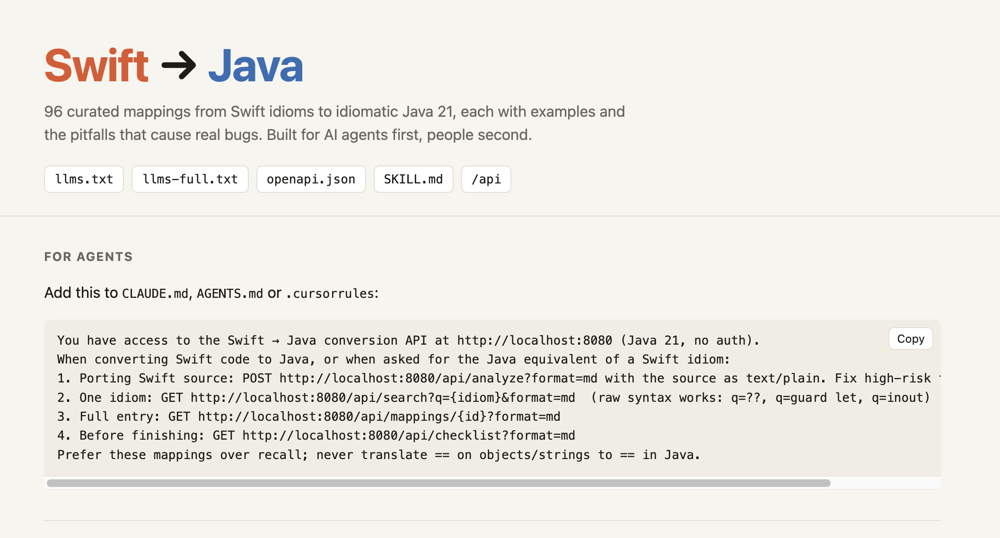
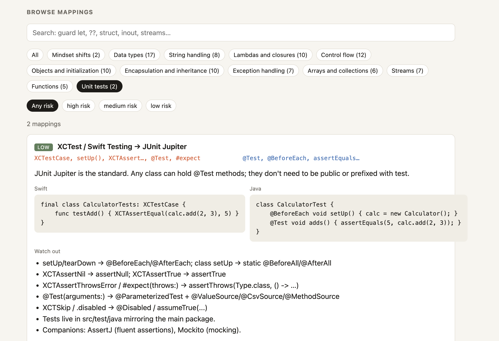
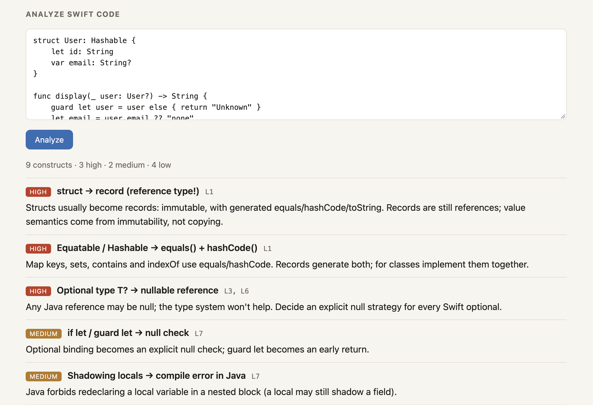

# Swift → Java

An agent-first API for converting Swift code to Java. It serves 96 curated mappings from Swift idioms to idiomatic Java 21, each with examples and the pitfalls that cause real bugs. You can browse and search the mappings, or send a Swift file and get back every construct it uses, by line and ordered by risk. AI coding agents are the main users, so every endpoint returns JSON or token-light Markdown (`?format=md`), and the API describes itself through `/api`, `llms.txt`, `SKILL.md` and `openapi.json`. A small web page on top of it is for people.

It's also a learning project: I'm an iOS developer porting a plain-Java reference implementation to Spring Boot, one step at a time. What each step taught me about building a Spring Boot backend for agents is in the [learning log](CLAUDE.md#learning-log).

## Screenshots

**For agents:** links to the discovery files and a snippet to paste into `CLAUDE.md`, `AGENTS.md` or `.cursorrules`.



**Browse mappings:** search by concept or raw Swift syntax, and filter by category and risk.



**Analyze Swift code:** paste Swift source and get the constructs it uses, with line numbers, ordered by risk.



## Run it

Requires Java 21.

```sh
./gradlew bootRun
```

Then open http://localhost:8080 for the web page, or http://localhost:8080/api for the endpoint index.
